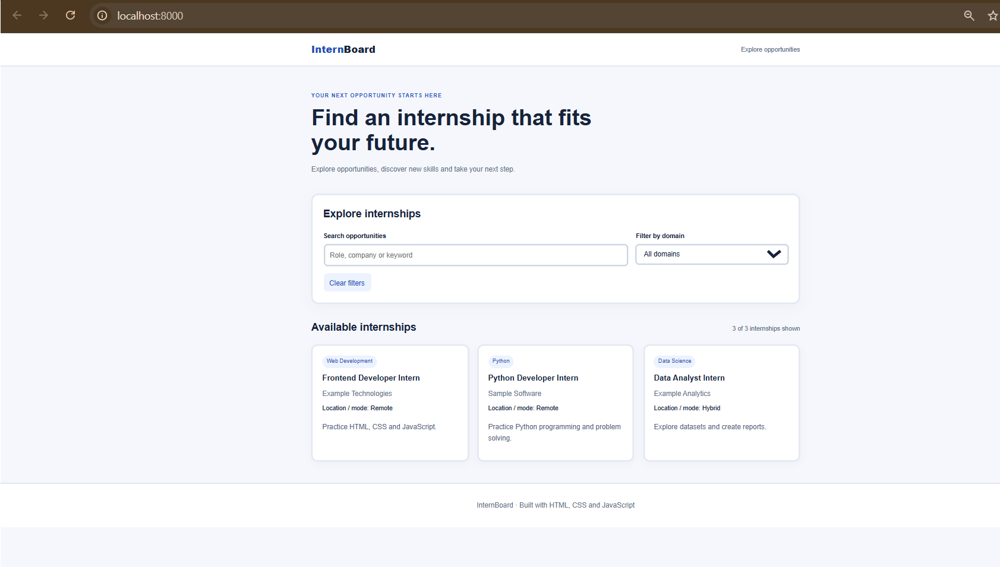
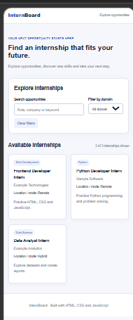
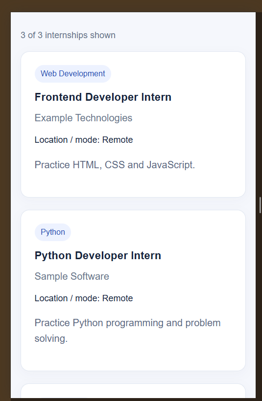
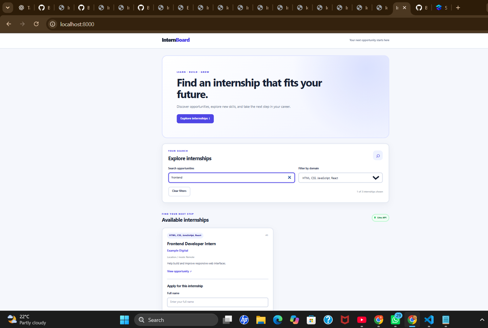
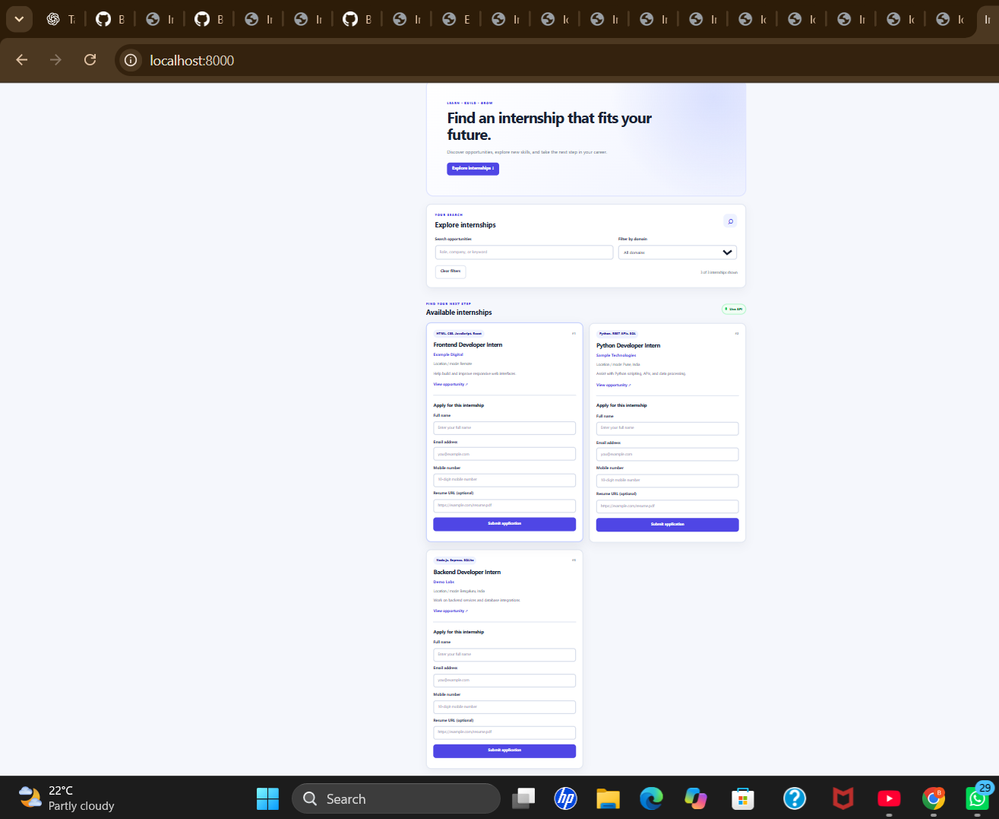
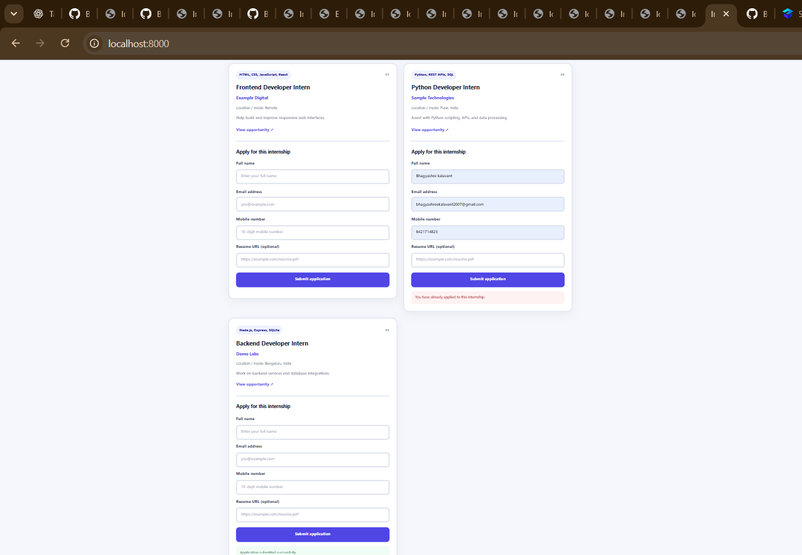
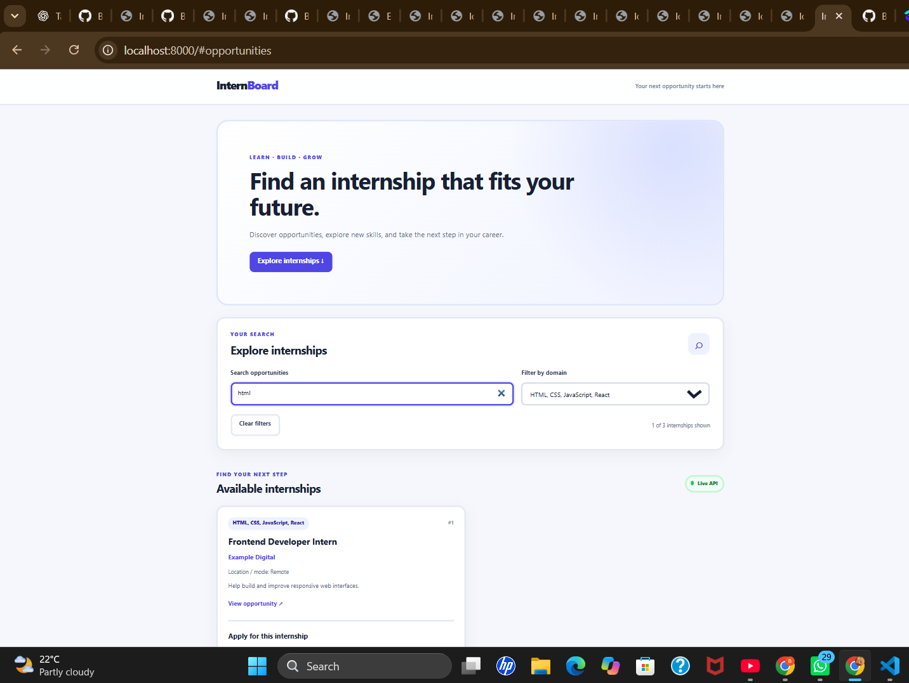

# Responsive Internship Board

A responsive internship listing website built using HTML, CSS, and JavaScript. This project allows users to explore internship opportunities, search internship records, and filter listings by domain through a simple and responsive user interface.

## Features

- Search internship records by keywords
- Filter internships by domain
- Responsive desktop, tablet, and mobile layouts
- Accessible form labels and keyboard navigation
- Loading, error, and empty states
- Internship data loaded from a JSON file
- Clean and user-friendly interface
- Project screenshots documenting the user interface

## Technologies Used

- HTML5
- CSS3
- JavaScript
- JSON
- Git
- GitHub
- GitHub Pages

## Live Demo

Visit the deployed website:

https://bhagyashree462.github.io/responsive-internship-board/?utm_source=chatgpt.com

## Source Code

GitHub Repository:

https://github.com/Bhagyashree462/responsive-internship-board

## Project Screenshots
### 1. Desktop.png — Desktop View

### 2. mobile.png — Mobile View

### 3. mobile1.png — Mobile View

### 4. mobile2.png — Mobile View

## Additional Project Screenshots

Add your other screenshots below. Replace the example filenames with the exact filenames saved in your `screenshots` folder.

### 5. Internship Search Results

### 6. Domain Filter

### 7. Application Form

### 8. Additional Interface View

## Data Source

This project uses fictional internship records supplied for the EdVyro task.

## Project Purposes

The purpose of this project is to demonstrate responsive web design, JavaScript-based search and filtering, JSON data handling, accessibility practices, and deployment using GitHub Pages.

## Author

**Bhagyashree Kalavant**

GitHub: https://github.com/Bhagyashree462
