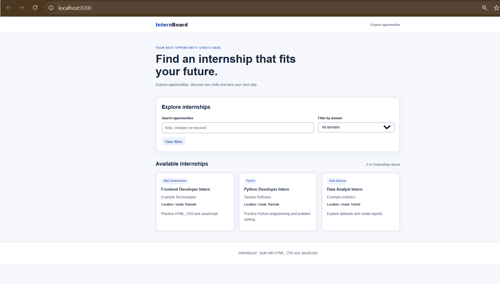
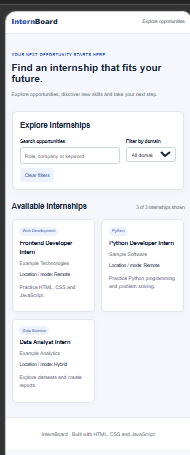
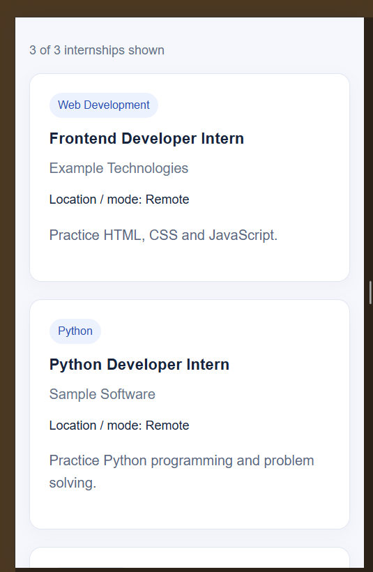
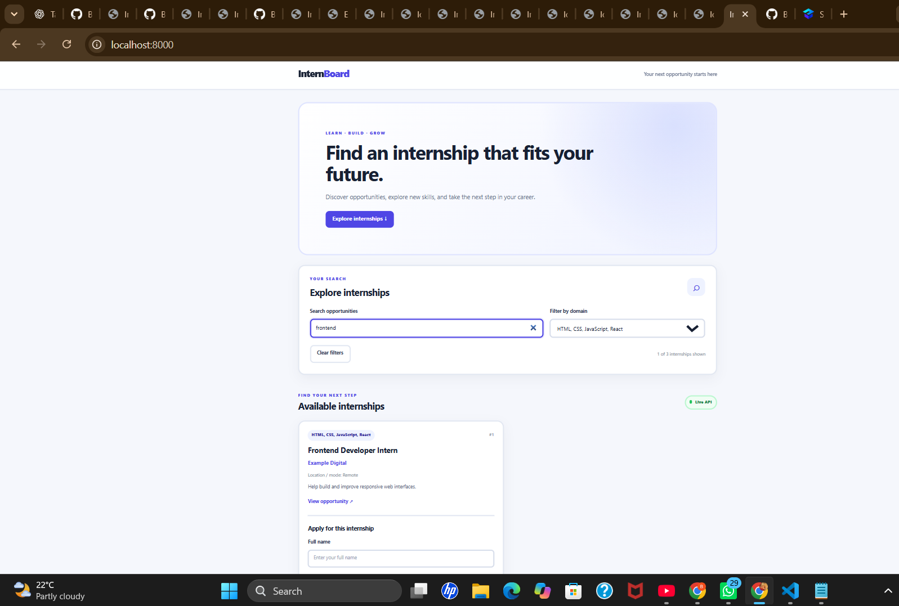
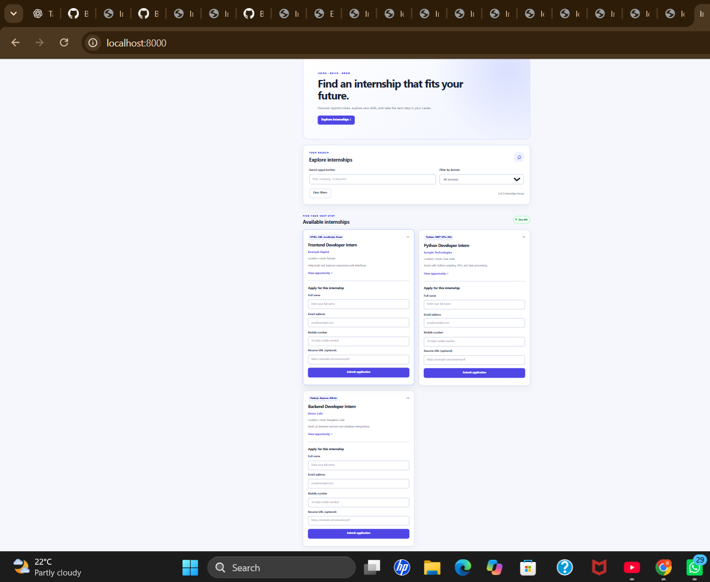
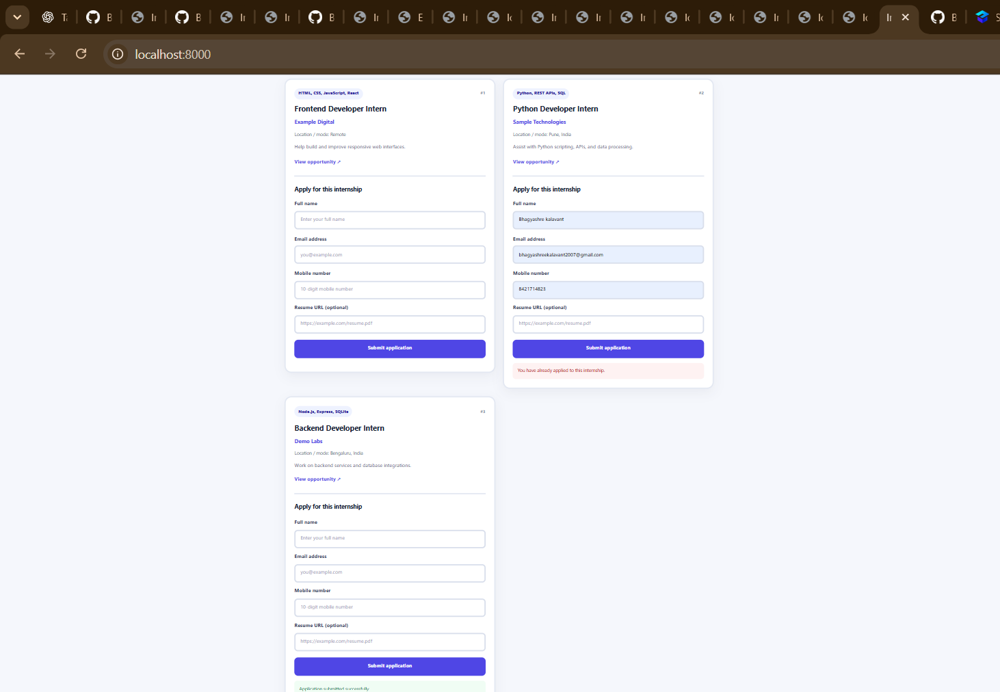
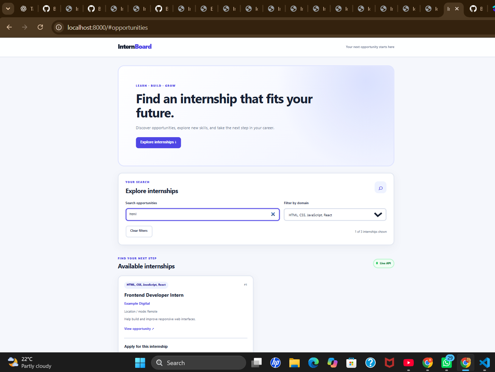

# Responsive Internship Board

A responsive internship listing website built using HTML, CSS, and JavaScript. This project allows users to explore internship opportunities, search internship records, and filter listings by domain through a simple and responsive user interface.

## Features

- Search internship records by keywords
- Filter internships by domain
- Responsive desktop, tablet, and mobile layouts
- Accessible form labels and keyboard navigation
- Loading, error, and empty states
- Internship data loaded from a JSON file
- Clean and user-friendly interface
- Project screenshots documenting the user interface

## Technologies Used

- HTML5
- CSS3
- JavaScript
- JSON
- Git
- GitHub
- GitHub Pages

## Live Demo

Visit the deployed website:

https://bhagyashree462.github.io/responsive-internship-board/?utm_source=chatgpt.com

## Source Code

GitHub Repository:

https://github.com/Bhagyashree462/responsive-internship-board

## Project Screenshots
### 1. Desktop.png — Desktop View


### 2. mobile.png — Mobile View


### 3. mobile1.png — Mobile View


### 4. mobile2.png — Mobile View


## Additional Project Screenshots

Add your other screenshots below. Replace the example filenames with the exact filenames saved in your `screenshots` folder.

### 5. Internship Search Results



### 6. Domain Filter



### 7. Application Form



### 8. Additional Interface View



## Data Source

This project uses fictional internship records supplied for the EdVyro task.

## Project Purposes

The purpose of this project is to demonstrate responsive web design, JavaScript-based search and filtering, JSON data handling, accessibility practices, and deployment using GitHub Pages.

## Author

**Bhagyashree Kalavant**

GitHub: https://github.com/Bhagyashree462

# Internship Board – Production-Ready Capstone

A full-stack Internship Board application that allows students to explore internship opportunities, search and filter listings, and submit applications through a REST API.

## 🌐 Live Demo

- **Frontend:** [https://bhagyashree462.github.io/responsive-internship-board/](https://bhagyashree462.github.io/responsive-internship-board/)
- **Backend API:** [https://internship-records-api.onrender.com](https://internship-records-api.onrender.com)
- **GitHub Frontend Repository:** [https://github.com/Bhagyashree462/responsive-internship-board](https://github.com/Bhagyashree462/responsive-internship-board)
- **GitHub Backend Repository:** [https://github.com/Bhagyashree462/internship-records-api](https://github.com/Bhagyashree462/internship-records-api)

## 📌 Project Overview

The Internship Board is designed to help students discover internship opportunities through a simple and responsive web interface.

The application connects a frontend website with a Node.js and Express.js backend. Internship records are stored in an SQLite database and accessed through RESTful API endpoints.

Students can browse available internships, search for opportunities, filter listings, and submit applications.

## ✨ Features

### Frontend Features

- Responsive and user-friendly interface.
- Display available internship opportunities.
- Search internships by keywords.
- Filter internships by domain or category.
- Display internship details, required skills, company and location.
- Apply through the application form.
- Connect frontend with the deployed backend API.

### Backend Features

- RESTful API using Node.js and Express.js.
- SQLite database integration.
- Create, read, update and delete internship records.
- Internship pagination.
- Input validation.
- Application submission endpoint.
- CORS configuration.
- Helmet security middleware.
- API rate limiting.
- Centralized error handling.
- Health-check endpoint.

## 🛠️ Technology Stack

| Category            | Technologies                     |
| ------------------- | -------------------------------- |
| Frontend            | HTML5, CSS3, JavaScript          |
| Backend             | Node.js, Express.js              |
| Database            | SQLite                           |
| API                 | REST API                         |
| Security            | Helmet, CORS, Express Rate Limit |
| Testing             | Node.js Test Runner              |
| Version Control     | Git, GitHub                      |
| Frontend Deployment | GitHub Pages                     |
| Backend Deployment  | Render                           |

## 🏗️ Project Structure

```text
responsive-internship-board/
│
├── index.html
├── style.css
├── script.js
├── internships.json
├── README.md
│
└── internship_api_task3/
    ├── data/
    ├── database/
    ├── seed/
    ├── src/
    │   ├── app.js
    │   ├── server.js
    │   ├── db.js
    │   ├── validation.js
    │   └── applicationValidation.js
    │
    ├── tests/
    ├── package.json
    └── package-lock.json
```

The backend is also maintained in a separate GitHub repository.

## 🔗 API Documentation

**Base URL:**

```text
https://internship-records-api.onrender.com
```

### Available Endpoints

| Method | Endpoint                           | Description                   |
| ------ | ---------------------------------- | ----------------------------- |
| GET    | `/health`                          | Check API health              |
| GET    | `/api/internships`                 | Get all internships           |
| GET    | `/api/internships?page=1&limit=10` | Get paginated internships     |
| GET    | `/api/internships/:id`             | Get internship by ID          |
| POST   | `/api/internships`                 | Create internship             |
| PUT    | `/api/internships/:id`             | Update internship             |
| DELETE | `/api/internships/:id`             | Delete internship             |
| POST   | `/api/applications`                | Submit internship application |

### Example API Request

```http
GET /api/internships?page=1&limit=10
```

### Example API Response

```json
{
  "data": [
    {
      "id": 1,
      "title": "Frontend Developer Intern",
      "company": "Example Digital",
      "location": "Remote",
      "mode": "Remote",
      "skills": [
        "HTML",
        "CSS",
        "JavaScript",
        "React"
      ]
    }
  ],
  "pagination": {
    "page": 1,
    "limit": 10,
    "total": 3,
    "totalPages": 1
  }
}
```

## 💻 Local Installation and Setup

### Prerequisites

- Node.js 22.5 or later
- npm
- Git
- Visual Studio Code (recommended)

### 1. Clone the Frontend Repository

```bash
git clone https://github.com/Bhagyashree462/responsive-internship-board.git
```

```bash
cd responsive-internship-board
```

### 2. Start the Frontend

Run:

```bash
python -m http.server 8000
```

Open:

```text
http://localhost:8000
```

### 3. Clone the Backend Repository

Open another terminal:

```bash
git clone https://github.com/Bhagyashree462/internship-records-api.git
```

```bash
cd internship-records-api
```

### 4. Install Backend Dependencies

```bash
npm install
```

### 5. Start the Backend Server

```bash
npm run dev
```

The backend runs at:

```text
http://localhost:3000
```

### 6. Configure the Frontend API URL

For local development, use:

```javascript
const API_BASE_URL = "http://localhost:3000";
```

For the deployed frontend, use:

```javascript
const API_BASE_URL =
  "https://internship-records-api.onrender.com";
```

## 🧪 Testing

The backend uses the Node.js built-in test runner.

Run the following command inside the backend directory:

```bash
npm test
```

### API Health Check

```bash
http://localhost:3000/health
```

### Test Internship Records

```bash
http://localhost:3000/api/internships?page=1&limit=10
```

### Testing Checklist

- [ ] Homepage loads successfully.
- [ ] Internship records are displayed.
- [ ] Search functionality works.
- [ ] Domain filters work.
- [ ] Internship details are displayed.
- [ ] Application form opens correctly.
- [ ] Application submission is tested.
- [ ] API health endpoint responds successfully.
- [ ] Internship API returns records.
- [ ] Pagination works.
- [ ] Invalid input is handled correctly.

## 🚀 Deployment

### Frontend – GitHub Pages

The frontend is deployed using GitHub Pages.

Live URL:

[https://bhagyashree462.github.io/responsive-internship-board/](https://bhagyashree462.github.io/responsive-internship-board/)

### Backend – Render

The backend REST API is deployed using Render.

Live API:

[https://internship-records-api.onrender.com](https://internship-records-api.onrender.com)

The backend uses SQLite for database storage.

**Deployment note:** SQLite persistence on Render depends on the configured persistent disk. Configure a persistent disk for production data that must survive service restarts or redeployments.

## 🔒 Security and Reliability

- Helmet security middleware.
- CORS configuration.
- API rate limiting.
- Input validation.
- Centralized error handling.
- Database connectivity checks.
- Pagination for internship records.

## 🎯 Project Objectives

- Build a responsive internship listing platform.
- Develop RESTful backend APIs.
- Integrate a relational database.
- Implement validation and security features.
- Deploy a full-stack application.
- Understand real-world frontend and backend integration.

## 👩‍💻 Developer

**Bhagyashree Kalavant**

B.Tech – Computer Science and Engineering

- GitHub: [https://github.com/Bhagyashree462](https://github.com/Bhagyashree462)
- LinkedIn: [https://www.linkedin.com/in/bhagyashree-kalavant-02659a349/](https://www.linkedin.com/in/bhagyashree-kalavant-02659a349/)
- Portfolio: [https://bhagyashree462.github.io/my-portfolio/](https://bhagyashree462.github.io/my-portfolio/)

---

⭐ If you find this project useful, consider giving the repository a star.
